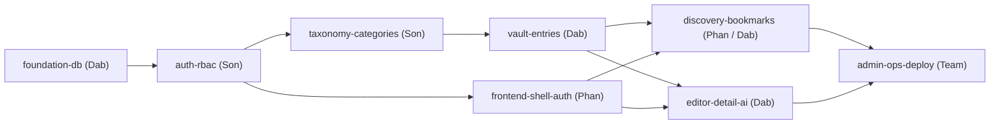

# Capability Map: Prompt Hub — Code Snippet & AI Prompt Vault

## Module Overview

Prompt Hub is decomposed into eight bounded capabilities with strict one-way dependencies. Each module maps directly to feature branches and team ownership across the 3-developer workflow.

| Module id | Responsibility | Owner | Depends on |
|---|---|---|---|
| `foundation-db` | Monorepo npm workspaces, Express/TS scaffold, PostgreSQL schema & migrations, `pg`/`PGlite` adapter, seed script, global error & Zod validation middlewares | `DABnoREGRET` (Dab) | `—` |
| `auth-rbac` | User registration, login, logout, `/api/auth/me`, `bcryptjs` password hashing, JWT issuance/verification, `USER`/`ADMIN` RBAC middleware | `SonPham15` (Son) | `foundation-db` |
| `taxonomy-categories` | Categories & tags read/write endpoints with Admin-only write protection and slug normalization | `SonPham15` (Son) | `auth-rbac` |
| `vault-entries` | Core Snippet & AI Prompt CRUD (`POST/GET/PATCH/DELETE /api/entries`), `PUBLIC`/`PRIVATE` visibility rules, author/admin ownership checks, search/filter/sort/pagination, bookmarks API | `DABnoREGRET` (Dab) | `auth-rbac`, `taxonomy-categories` |
| `frontend-shell-auth` | React 19 + Vite + Tailwind + React Router shell, `AuthContext`, Login/Register flows, protected route guards, shared Loading/Empty/Error/Toast primitives | `phanh1475` (Phan) | `auth-rbac` |
| `discovery-bookmarks` | Public Explore feed with debounced search, category/type/language filters, sorting, pagination, and personal Bookmarks view | `phanh1475` (Phan) + `DABnoREGRET` (Dab) | `vault-entries`, `frontend-shell-auth` |
| `editor-detail-ai` | Entry Detail page (syntax-highlighted code, one-click copy, interactive `{{variable}}` Prompt Playground), Create/Edit Entry form, My Vault, and AI Assistant (`/api/ai/analyze`) | `DABnoREGRET` (Dab) | `vault-entries`, `frontend-shell-auth` |
| `admin-ops-deploy` | Admin moderation API & dashboard, security hardening (`helmet`, rate limiting), GitHub Actions CI + GitHub Pages deploy, Render Blueprint (`render.yaml`) | `SonPham15` (Son) + `DABnoREGRET` (Dab) + `phanh1475` (Phan) | `vault-entries`, `discovery-bookmarks`, `editor-detail-ai` |

## Build Order & Dependency Graph

```text
Build order: foundation-db → auth-rbac → taxonomy-categories, frontend-shell-auth → vault-entries → discovery-bookmarks, editor-detail-ai → admin-ops-deploy
```



## Module Spec & Documentation Index

- Master V1 Specification: [SPEC.md](./SPEC.md)
- Functional Specification & Use Cases: [FUNCTIONAL_SPECIFICATION.md](./FUNCTIONAL_SPECIFICATION.md)
- Implementation & Deployment Guide: [IMPLEMENTATION_GUIDE.md](./IMPLEMENTATION_GUIDE.md)
- Database Schema & ERD: [docs/DATABASE_SCHEMA.md](./docs/DATABASE_SCHEMA.md)
- Architecture Decisions: [docs/decisions/](./docs/decisions/)
