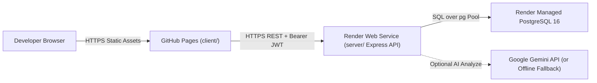

# Implementation & Deployment Guide — Prompt Hub

Reference spec: [SPEC.md](./SPEC.md) | Database schema: [docs/DATABASE_SCHEMA.md](./docs/DATABASE_SCHEMA.md)

## 1. System Architecture

Prompt Hub separates a static React SPA hosted on **GitHub Pages** from a stateless Node.js/Express REST API and **PostgreSQL** database hosted on **Render**.

### Cross-Origin Authentication Design
Because GitHub Pages (`https://<owner>.github.io`) and Render (`https://<service>.onrender.com`) reside on different sites, third-party cookies are blocked by modern browsers. Prompt Hub uses stateless `Authorization: Bearer <jwt>` headers with explicit CORS origin whitelisting (`CORS_ORIGIN`) — see [ADR-003](./docs/decisions/ADR-003-jwt-auth-and-rbac.md).

## 2. Backend Layered Structure (`server/src/`)

Every backend module strictly separates HTTP transport, validation, business logic, and SQL persistence:

1. **`routes/`**: Maps REST endpoints (`GET/POST/PATCH/DELETE`) and composes middlewares (`authenticate`, `requireRole`, `validateBody`).
2. **`middlewares/`**:
   - `auth.ts`: Verifies JWT Bearer token and attaches `req.user` (`optionalAuth` for guest-accessible endpoints).
   - `role.ts`: Guards admin-only routes (`requireRole('ADMIN')`).
   - `validate.ts`: Validates `req.body` and `req.query` via Zod, returning standardized `422 VALIDATION_ERROR`.
   - `errorHandler.ts`: Centralized Express error handler mapping `AppError` and unexpected faults to `{ error: { code, message, details? } }`.
3. **`controllers/`**: Extracts validated inputs and returns consistent JSON responses + HTTP status codes (`200`, `201`, `204`, `400`, `401`, `403`, `404`, `409`, `422`, `500`).
4. **`services/`**: Enforces ownership rules, password hashing/verification, tag normalization, and AI analysis orchestration.
5. **`models/`**: Parameterized SQL queries via the shared DB adapter (`db/client.ts`), supporting both `pg.Pool` (production/external Postgres) and `@electric-sql/pglite` (local dev/CI fallback).

## 3. Frontend Architecture (`client/src/`)

1. **`api/`**: Centralized `fetch` wrapper (`apiClient.ts`) injecting `VITE_API_BASE_URL` and the JWT token, normalizing API errors into typed exceptions, and exposing a warm-up health probe (`GET /api/health`) for Render free-tier wakeups.
2. **`context/AuthContext.tsx`**: Hydrates user session on mount via `/api/auth/me`, exposes `login`, `register`, `logout`, and role helpers.
3. **`pages/` & `components/`**:
   - Container pages manage async state machines (`loading`, `empty`, `error`, `success`).
   - Presentational components (`EntryCard`, `FilterBar`, `PromptPlayground`, `AiAssistantPanel`, `StatusBanner`) stay decoupled and accessible (WCAG 2.1 AA).
   - Uses `HashRouter` so deep links (e.g., `/#/entries/12`) never 404 on static GitHub Pages hosting.

## 4. Step-by-Step Build Sequence

1. **Step 1 — Workspace & Database Foundation**: Initialize root npm workspaces, Express TypeScript server, SQL migration (`001_init.sql`), `pg`/`PGlite` adapter, seed script, and `/api/health`.
2. **Step 2 — Authentication & RBAC**: Implement `bcryptjs` hashing, JWT helpers, `/api/auth/*` endpoints, `authenticate` & `requireRole` middlewares, and Supertest auth integration tests.
3. **Step 3 — Categories & Tags Taxonomy**: Implement `/api/categories` (public `GET`, admin `POST/PATCH/DELETE`) and `/api/tags`.
4. **Step 4 — Frontend Shell & Auth UI**: Scaffold Vite + React + Tailwind + `HashRouter`, `AuthContext`, Login/Register pages, Navbar, and Loading/Empty/Error/Toast components.
5. **Step 5 — Vault Entries CRUD & Discovery API**: Implement `/api/entries` (`GET` with search/filter/sort/pagination, `GET /mine`, `GET /:id`, `POST`, `PATCH`, `DELETE`), visibility/ownership enforcement, and `/api/entries/:id/bookmark`.
6. **Step 6 — Explore UI, Detail & Prompt Playground, Editor**: Build Explore feed with debounced search & URL query sync, Entry Detail with syntax copy & `{{variable}}` Prompt Playground, Create/Edit form, and My Vault.
7. **Step 7 — AI Assistant & Admin Hardening**: Implement `/api/ai/analyze` (Gemini + deterministic fallback) + `AiAssistantPanel`, `/api/admin/*` endpoints + Admin UI, `helmet`, and auth rate limiting.
8. **Step 8 — CI/CD & Cloud Deployment**: Configure GitHub Actions CI, GitHub Pages deployment, and Render Blueprint (`render.yaml`).

## 5. Deployment Guide: GitHub Pages + Render

### A. Backend & Database on Render
1. Push repository containing `render.yaml` to GitHub.
2. In Render Dashboard (or via `render blueprint launch`), create a Blueprint pointing to the repository:
   - Provisions a Managed PostgreSQL database (`prompthub-db`).
   - Provisions the Node.js Web Service (`prompthub-api`) with:
     - **Build Command**: `npm ci && npm run build --workspace=server`
     - **Start Command**: `npm run db:migrate --workspace=server && npm run db:seed --workspace=server && npm run start --workspace=server`
     - **Health Check Path**: `/api/health`
3. Set secrets in Render Environment Variables:
   - `NODE_ENV=production`
   - `USE_PGLITE=false`
   - `DATABASE_URL` (auto-linked from `prompthub-db`)
   - `JWT_SECRET` (auto-generated 64-char secret in `render.yaml`)
   - `CORS_ORIGIN=https://<github-username>.github.io`
   - `GEMINI_API_KEY` (optional; leave empty to use deterministic analyzer fallback)

### B. Frontend on GitHub Pages
1. In `client/vite.config.ts`, set `base: process.env.VITE_BASE_PATH || '/'` (set to `'/prompt-hub/'` in GitHub Actions).
2. In GitHub Repository **Settings → Secrets and variables → Actions → Variables**, add:
   - `VITE_API_BASE_URL` = `https://<your-render-service>.onrender.com/api`
3. In **Settings → Pages**, set **Source** to **GitHub Actions**.
4. Pushing to `main` triggers `.github/workflows/deploy-pages.yml`, building `client/dist` and publishing live to `https://<github-username>.github.io/prompt-hub/`.
