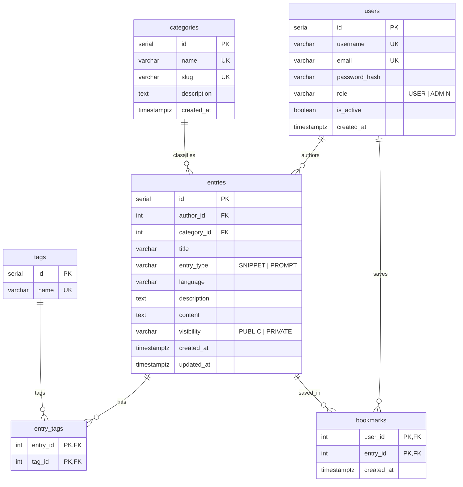

# Database Schema & ERD — Prompt Hub

Reference spec: [SPEC.md](../SPEC.md)

## Entity-Relationship Diagram

## Table Definitions & Constraints

### 1. `users`
Stores registered accounts and RBAC roles. Passwords are stored strictly as `bcryptjs` hashes (`password_hash`), never plain text.

| Column | Type | Constraints | Notes |
|---|---|---|---|
| `id` | `SERIAL` | `PRIMARY KEY` | Auto-increment user ID |
| `username` | `VARCHAR(30)` | `NOT NULL UNIQUE` | Public display handle |
| `email` | `VARCHAR(255)` | `NOT NULL UNIQUE` | Normalized lowercase email |
| `password_hash` | `VARCHAR(255)` | `NOT NULL` | Bcrypt hash (cost >= 10) |
| `role` | `VARCHAR(16)` | `NOT NULL DEFAULT 'USER' CHECK (role IN ('USER','ADMIN'))` | RBAC role |
| `is_active` | `BOOLEAN` | `NOT NULL DEFAULT TRUE` | Admin moderation flag |
| `created_at` | `TIMESTAMPTZ` | `NOT NULL DEFAULT NOW()` | Registration timestamp |

### 2. `categories`
Primary taxonomy for grouping snippets and AI prompts (e.g., `Backend API`, `React & UI`, `SQL & Data`, `System Prompts`, `DevOps & CI`, `Testing & QA`).

| Column | Type | Constraints | Notes |
|---|---|---|---|
| `id` | `SERIAL` | `PRIMARY KEY` | Category ID |
| `name` | `VARCHAR(50)` | `NOT NULL UNIQUE` | Display name |
| `slug` | `VARCHAR(60)` | `NOT NULL UNIQUE` | URL-safe filter slug |
| `description` | `TEXT` | `DEFAULT ''` | Short summary |
| `created_at` | `TIMESTAMPTZ` | `NOT NULL DEFAULT NOW()` | Creation time |

### 3. `entries`
Core vault table holding both reusable code snippets (`SNIPPET`) and parameterized AI prompts (`PROMPT`).

| Column | Type | Constraints | Notes |
|---|---|---|---|
| `id` | `SERIAL` | `PRIMARY KEY` | Entry ID |
| `author_id` | `INTEGER` | `NOT NULL REFERENCES users(id) ON DELETE CASCADE` | Owner user |
| `category_id` | `INTEGER` | `REFERENCES categories(id) ON DELETE SET NULL` | Optional category |
| `title` | `VARCHAR(120)` | `NOT NULL` | Concise title |
| `entry_type` | `VARCHAR(16)` | `NOT NULL CHECK (entry_type IN ('SNIPPET','PROMPT'))` | Item classification |
| `language` | `VARCHAR(40)` | `NOT NULL` | Syntax/prompt format |
| `description` | `TEXT` | `NOT NULL DEFAULT ''` | Usage notes |
| `content` | `TEXT` | `NOT NULL` | Code body or `{{variable}}` prompt |
| `visibility` | `VARCHAR(16)` | `NOT NULL DEFAULT 'PUBLIC' CHECK (visibility IN ('PUBLIC','PRIVATE'))` | Access boundary |
| `created_at` | `TIMESTAMPTZ` | `NOT NULL DEFAULT NOW()` | Created timestamp |
| `updated_at` | `TIMESTAMPTZ` | `NOT NULL DEFAULT NOW()` | Last updated timestamp |

### 4. `tags` & 5. `entry_tags`
Normalized M:N tagging model avoiding comma-separated strings or duplicated tag text.

- `tags`: `id SERIAL PRIMARY KEY`, `name VARCHAR(24) NOT NULL UNIQUE`
- `entry_tags`: `entry_id INTEGER NOT NULL REFERENCES entries(id) ON DELETE CASCADE`, `tag_id INTEGER NOT NULL REFERENCES tags(id) ON DELETE CASCADE`, `PRIMARY KEY (entry_id, tag_id)`

### 6. `bookmarks`
Normalized M:N join table tracking saved entries per user. Popularity counts are derived cleanly via `COUNT(bookmarks.entry_id)` rather than storing redundant counters that can drift.

- `user_id INTEGER NOT NULL REFERENCES users(id) ON DELETE CASCADE`
- `entry_id INTEGER NOT NULL REFERENCES entries(id) ON DELETE CASCADE`
- `created_at TIMESTAMPTZ NOT NULL DEFAULT NOW()`
- `PRIMARY KEY (user_id, entry_id)`

## Index Strategy

- `idx_entries_visibility_created` on `entries(visibility, created_at DESC)` — accelerates public Explore feed pagination.
- `idx_entries_author` on `entries(author_id, updated_at DESC)` — accelerates `My Vault` queries.
- `idx_entries_category` on `entries(category_id)` and `idx_entries_type` on `entries(entry_type)` — accelerates filtered discovery.
- `idx_entry_tags_tag` on `entry_tags(tag_id)` — accelerates tag-filtered lookups.
- `idx_bookmarks_entry` on `bookmarks(entry_id)` — accelerates bookmark count aggregations for `sortBy=popular`.

## Seed Data Inventory

The idempotent `seed.ts` script populates realistic demo records:
- **3 Users**: 1 `ADMIN` (`admin@prompthub.dev`), 2 `USER` accounts (`dab@prompthub.dev`, `phan@prompthub.dev`).
- **6 Categories**: `Backend API`, `React & UI`, `SQL & Data`, `AI System Prompts`, `DevOps & CI`, `Testing & QA`.
- **12 Tags**: `typescript`, `express`, `react`, `postgres`, `tailwind`, `zod`, `code-review`, `sql-tuning`, `docker`, `testing`, `refactoring`, `api-design`.
- **15 Entries**: 9 reusable `SNIPPET` items + 6 parameterized `{{variable}}` `PROMPT` items (mix of `PUBLIC` and `PRIVATE` ownership) plus sample `bookmarks`.
